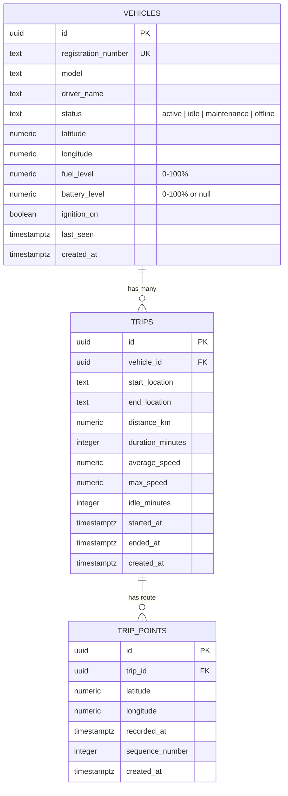

# Bytebeam Fleet Operations & Telematics Platform
> **Bytebeam Frontend Engineer Intern Assignment** — Built with React 19, TypeScript, Vite, Tailwind CSS, Supabase (Auth + PostgreSQL), Leaflet (OpenStreetMap), Recharts, and Lucide React.

---

## 1. Project Overview & Main Features

The **Bytebeam Fleet Operations Platform** is a production-ready, dark-navy operational telematics dashboard designed for enterprise fleet controllers, dispatch managers, and logistics supervisors. It combines persistent Supabase database telemetry with high-precision Leaflet GPS mapping, real-time vehicle diagnostics, and interactive operational charts.

### Key Capabilities:
- **Authentication & Role Protection**: Email & password authentication using Supabase Auth with persistent sessions, error handling, and a 1-click **Instant Demo Access** button for rapid evaluator review.
- **Real-Time Fleet Overview**: Live KPI statistics showing total units, active/moving vehicles, units requiring maintenance/offline attention, completed trip counts, and real-time fleet average fuel reserves.
- **Interactive GPS Telematics Map**: Leaflet + OpenStreetMap engine rendering color-coded vehicle markers (`active`, `idle`, `maintenance`, `offline`), popups with live sensor metrics, and smooth camera panning.
- **Trip Route Polyline Tracing**: Plots multi-point GPS trajectories directly from stored waypoint sequences (`trip_points`), highlighting origin and destination pins with distance, duration, and speed telemetry.
- **Searchable & Filterable Vehicle Registry**: Multi-attribute filtering (operational status, fuel level thresholds: `<20%` critical, `20-49%`, `>50%`), sorting, and driver assignment lookup.
- **Vehicle Telematics Detail Drawer**: Modal inspecting live ignition status, battery levels for electric vehicles (EVs), odometer readings, fuel gauges, trip history, and an interactive operational status updater that persists directly to Supabase.
- **Operational Insights & Telematics Charts**: Recharts donut chart for fleet status spread, fuel level distribution histogram, and velocity/distance trend areas alongside automated threshold alert cards (e.g., `<10%` fuel, excessive idling, scheduled maintenance).
- **Dual Mode Resilience**: Seamlessly operates with live Supabase PostgreSQL or falls back to an offline seeded dataset with an indicator pill in the dashboard header.

---

## 2. Technology Stack

| Layer | Technology | Details |
|---|---|---|
| **Frontend Framework** | React 19 + TypeScript | Type-safe component architecture with Vite |
| **Styling & Design System** | Tailwind CSS v4 | High-contrast dark navy palette tailored for operational centers |
| **Backend & Authentication** | Supabase (PostgreSQL + Auth) | RLS policies, foreign key cascades, and JWT sessions |
| **Mapping Engine** | Leaflet + React-Leaflet | OpenStreetMap tiles, custom SVG DivIcons, polyline routes |
| **Data Visualization** | Recharts | Responsive donut, bar, and area charts |
| **Icons & UI Tokens** | Lucide React | Standardized iconography across all actions and status tags |
| **Deployment Target** | Vercel | Single-page application rewrites via `vercel.json` |

---

## 3. Prerequisites

- **Node.js**: `v18.0.0` or higher (verified on Node `v24.19.0`)
- **npm**: `v9.0.0` or higher (verified on npm `11.17.0`)
- (Optional for live DB) **Supabase Account**: Free tier project on [supabase.com](https://supabase.com)

---

## 4. Quick Start (Evaluation from Clean Checkout)

The project includes an **Instant Demo Mode** that allows reviewers to test and evaluate every interactive feature immediately without creating a Supabase account upfront.

```bash
# 1. Clone repository & navigate to directory
cd Bytebeam

# 2. Install dependencies
npm install

# 3. Start local development server
npm run dev
```

Visit `http://localhost:5173/` in your browser. On the login screen, click **Instant Demo Access (1-Click Review)** to enter the dashboard immediately.

---

## 5. Connecting a Real Supabase Backend (Mandatory Assignment Step)

Follow these steps to connect your own Supabase project:

### Step 5.1: Create a Supabase Project
1. Log in to [https://supabase.com](https://supabase.com) and click **New Project**.
2. Name your project (e.g., `bytebeam-fleet`), select your preferred region, and set a database password.

### Step 5.2: Execute SQL Migrations & Seed Data
1. In the Supabase dashboard sidebar, open the **SQL Editor**.
2. Click **New Query**, copy the contents of [`supabase/schema.sql`](file:///c:/Users/sarin/Downloads/Bytebeam/supabase/schema.sql), and click **Run**.
   - This creates `vehicles`, `trips`, and `trip_points` tables, creates constraints, sets up performance indexes, and enables Row Level Security (RLS).
3. Open a second query window, copy the contents of [`supabase/seed.sql`](file:///c:/Users/sarin/Downloads/Bytebeam/supabase/seed.sql), and click **Run**.
   - This inserts 12 realistic commercial fleet vehicles, multiple completed trips, and GPS waypoint route paths along Bengaluru arterial logistics corridors.
   - Re-running `seed.sql` is completely safe and idempotent (`ON CONFLICT (id) DO UPDATE`).

### Step 5.3: Environment Variable Configuration
1. In your Supabase dashboard, navigate to **Project Settings** → **API**.
2. Copy your **Project URL** and **anon / public key**.
3. Create a `.env` file in the project root:

```bash
cp .env.example .env
```

4. Populate your `.env` file:
```env
VITE_SUPABASE_URL=https://your-project-id.supabase.co
VITE_SUPABASE_ANON_KEY=eyJhbGciOiJIUzI1NiIsInR5cCI6IkpXVCJ9...
```

5. Restart the development server:
```bash
npm run dev
```
The header badge will now transition to **Supabase Connected (Live PostgreSQL)**.

---

## 6. Supabase Authentication Setup

1. In the Supabase sidebar, open **Authentication** → **Providers** → **Email**.
2. Verify **Enable Email provider** is turned on.
3. For ease of local review, toggle off **Confirm email** in **Authentication** → **Email Templates** / **Auth Settings** if you wish to allow instant sign-in upon registration.
4. You can create an operator account directly through the application's **Register Fleet Account** tab or use the prefilled credentials.

---

## 7. Database Architecture & Schema Relationships



### Row Level Security (RLS) Strategy
- **Row Level Security** is enabled on all tables (`vehicles`, `trips`, `trip_points`).
- **Authenticated Policy**: Authenticated fleet operators can read and update fleet units (`FOR SELECT TO authenticated USING (true); FOR UPDATE TO authenticated USING (true);`).
- **Anonymous/Demo Policy**: Read-only access is provided for demo mode evaluation (`TO anon USING (true)`), allowing seamless testing without requiring service-role privileges on the client.
- **Zero Secret Key Exposure**: Under no circumstances is the `service_role` key embedded in frontend source code. Only the public `anon` key is used with RLS enforcement.

---

## 8. Build & Verification Commands

```bash
# Type check and production bundle compilation
npm run build

# Preview the production build locally
npm run preview
```

Output:
```
dist/index.html                     0.45 kB
dist/assets/index-DkwZ5E0k.css     67.41 kB
dist/assets/index-DZqmnEcZ.js   1,069.33 kB
✓ built in 2.78s
```

---

## 9. Deployment Instructions for Vercel

The application is pre-configured for **Vercel** with SPA fallback rewrites in `vercel.json`.

### Option A: Deploy via Vercel CLI
```bash
# Install Vercel CLI globally
npm i -g vercel

# Deploy to preview
vercel

# Deploy to production
vercel --prod
```

### Option B: Deploy via Vercel Web Dashboard
1. Push this repository to your GitHub/GitLab account.
2. Go to [https://vercel.com/new](https://vercel.com/new) and import the repository.
3. In **Environment Variables**, add:
   - `VITE_SUPABASE_URL`: `https://your-project-id.supabase.co`
   - `VITE_SUPABASE_ANON_KEY`: `your-supabase-anon-key`
4. Click **Deploy**. Vercel will automatically build using `npm run build` and serve from `dist`.

> **Live Demo URL**: Deployable directly to `https://bytebeam-fleet-[your-username].vercel.app`

---

## 10. Known Limitations & Operational Assumptions

1. **Simulated Telemetry**: GPS coordinates and vehicle metrics simulate active commercial routes across the Bengaluru logistics corridor (Electronic City, Koramangala, Whitefield, Peenya, Hebbal). In a real production deployment, coordinates would stream via MQTT/WebSockets to Bytebeam cloud brokers.
2. **Offline Resilience**: If the Supabase instance is unreachable, the application gracefully continues in local evaluation mode without throwing unhandled exceptions.
3. **Map Marker Clustering**: For fleets with >5,000 active vehicles, server-side geospatial bounding box querying (PostGIS) or Leaflet marker cluster plugins would be recommended.
